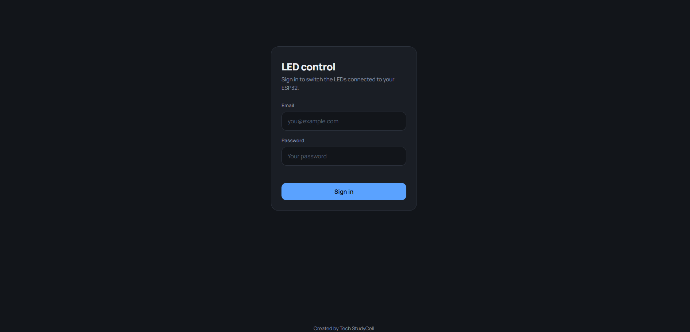
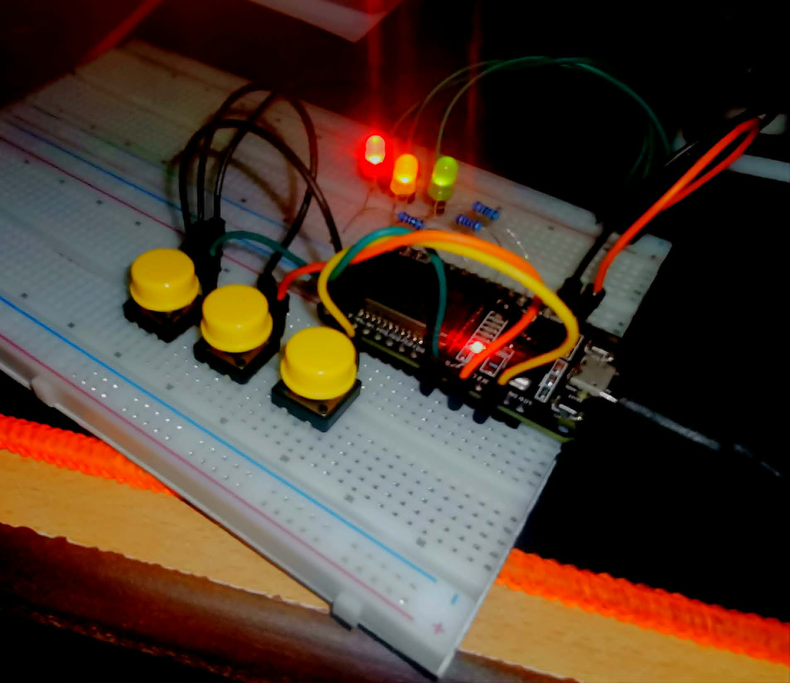

# ESP32 LED Control

A real-time IoT LED control project built around an ESP32, three LEDs, and three physical toggle switches. Each LED can be toggled independently from physical push-buttons or remotely from a Firebase-connected web dashboard — with state kept in sync both ways via Firebase Realtime Database, secured behind Firebase Authentication.

## ⚡ TL;DR

The ESP32 reads three push-button switches (Green, Yellow, Red). Pressing a switch toggles the corresponding LED and pushes the new state to Firebase (`/led1`, `/led2`, `/led3`). The loop also polls Firebase every 100 ms so a remote command from the web dashboard (or any Firebase client) is immediately reflected on the physical LEDs — giving true bidirectional control.

---

## ✨ Key Features

- **Bidirectional control** — physical switches and remote Firebase writes both drive the LEDs
- **Three independent channels** — Green (GPIO 4), Yellow (GPIO 5), and Red (GPIO 18)
- **Debounced switch reading** — 20 ms software debounce prevents false triggers
- **Startup state restore** — reads `/led1`, `/led2`, `/led3` on boot and restores LEDs to their last known state
- **Firebase Authentication** — uses email/password auth so only authorised users can write to the database
- **PlatformIO project** — one-command build and flash with `pio run --target upload`

---

## 🔄 How It Works

```
Physical switch pressed
    → ESP32 detects edge (HIGH → LOW = pressed, with INPUT_PULLUP)
    → 20 ms debounce confirmation
    → Toggles LED state
    → Writes new bool to Firebase (/led1 | /led2 | /led3)

Firebase write (from dashboard or any client)
    → ESP32 polls /led1, /led2, /led3 every 100 ms
    → Compares Firebase value with current local state
    → If different → updates LED and local state variable

Startup
    → Connects to Wi-Fi
    → Authenticates with Firebase (email + password)
    → Reads /led1, /led2, /led3 and restores LED outputs
    → Saves current switch states as baseline for edge detection
```

---

## 🔧 Hardware

| Component | Purpose |
|-----------|---------|
| ESP32 | Main microcontroller — Wi-Fi, Firebase client, GPIO control |
| Green LED | Controlled by `/led1` in Firebase |
| Yellow LED | Controlled by `/led2` in Firebase |
| Red LED | Controlled by `/led3` in Firebase |
| Push-button (Green) | Physically toggles the Green LED |
| Push-button (Yellow) | Physically toggles the Yellow LED |
| Push-button (Red) | Physically toggles the Red LED |

---

## 🔌 Wiring

| Component | ESP32 GPIO |
|-----------|-----------|
| Green LED | GPIO 4 |
| Yellow LED | GPIO 5 |
| Red LED | GPIO 18 |
| Switch — Green | GPIO 13 (INPUT_PULLUP) |
| Switch — Yellow | GPIO 14 (INPUT_PULLUP) |
| Switch — Red | GPIO 26 (INPUT_PULLUP) |

> All switches are wired between the GPIO pin and GND. `INPUT_PULLUP` keeps the line HIGH at rest; pressing the button pulls it LOW.
> LEDs should be wired in series with an appropriate current-limiting resistor (typically 220 Ω–330 Ω) to GND.

---

## 🖥️ Project Images

### Wiring & Hardware


### Firebase Realtime Database


### Web Dashboard — Login



### Web Dashboard — Controls


### Live State in Realtime



---

## ⚙️ Configuration

Open `src/main.cpp` and fill in your credentials before flashing:

```cpp
// Wi-Fi
const char* ssid     = "YOUR_WIFI_SSID";
const char* password = "YOUR_WIFI_PASSWORD";

// Firebase
#define API_KEY       "YOUR_FIREBASE_API_KEY"        // Project Settings > General
#define DATABASE_URL  "YOUR_FIREBASE_DATABASE_URL"   // Realtime Database URL
#define USER_EMAIL    "YOUR_FIREBASE_USER_EMAIL"     // Firebase Auth email
#define USER_PASSWORD "YOUR_FIREBASE_USER_PASSWORD"
```

---

## 🚀 Getting Started

### Prerequisites

- [PlatformIO](https://platformio.org/) (IDE extension or CLI)
- ESP32 board
- Firebase project with **Realtime Database** and **Authentication** (Email/Password provider) enabled

### Firebase Database Rules (example)

```json
{
  "rules": {
    ".read":  "auth != null",
    ".write": "auth != null"
  }
}
```

### Build & Flash

```bash
# Install dependencies and flash
pio run --target upload

# Open serial monitor
pio device monitor --baud 115200
```

---

## 📦 Dependencies

| Library | Version |
|---------|---------|
| [Firebase Arduino Client Library for ESP8266 and ESP32](https://github.com/mobizt/Firebase-ESP-Client) | `^4.4.17` |

Managed automatically by PlatformIO via `platformio.ini`.

---

## 📁 Project Structure

```
LED Control/
├── src/
│   └── main.cpp          # Main firmware (setup + loop)
├── include/              # Header files (PlatformIO default)
├── lib/                  # Local libraries (PlatformIO default)
├── images/               # Project photos and screenshots
├── platformio.ini        # Board, framework, and library config
└── README.md
```

---

## 📡 Firebase Data Structure

```
/
├── led1   (bool)   → Green LED state
├── led2   (bool)   → Yellow LED state
└── led3   (bool)   → Red LED state
```

Any authenticated client can read or write these values. The ESP32 reads them every loop iteration (every 100 ms) and updates the physical LEDs accordingly.
